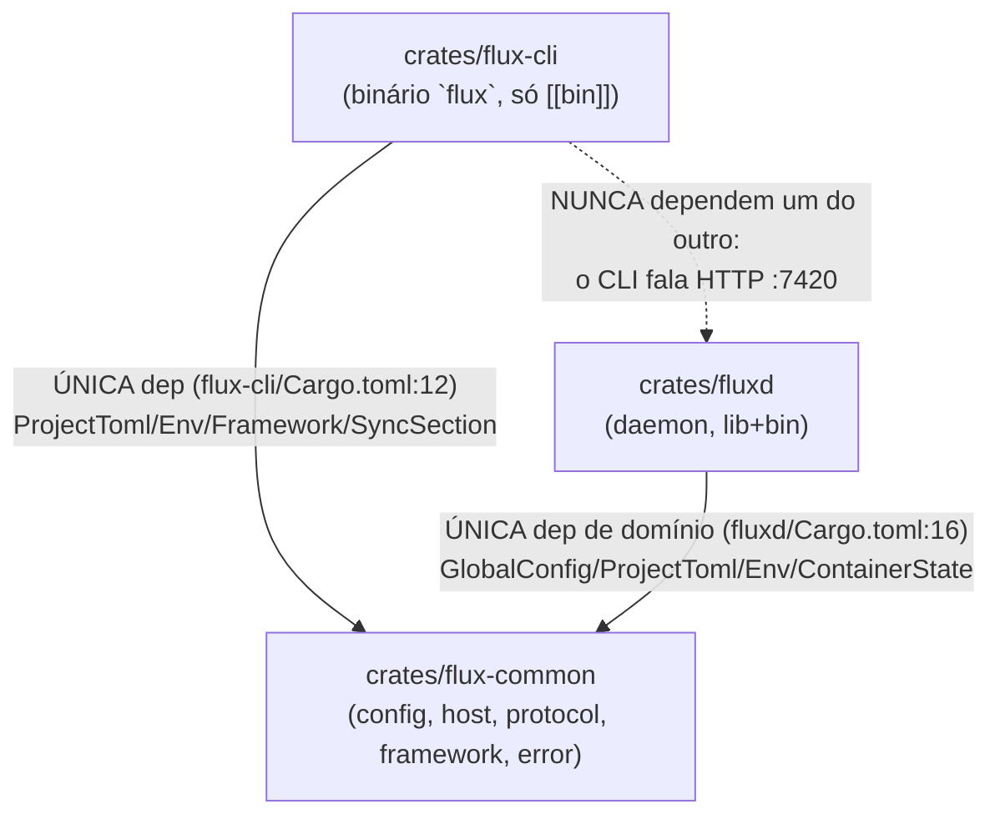
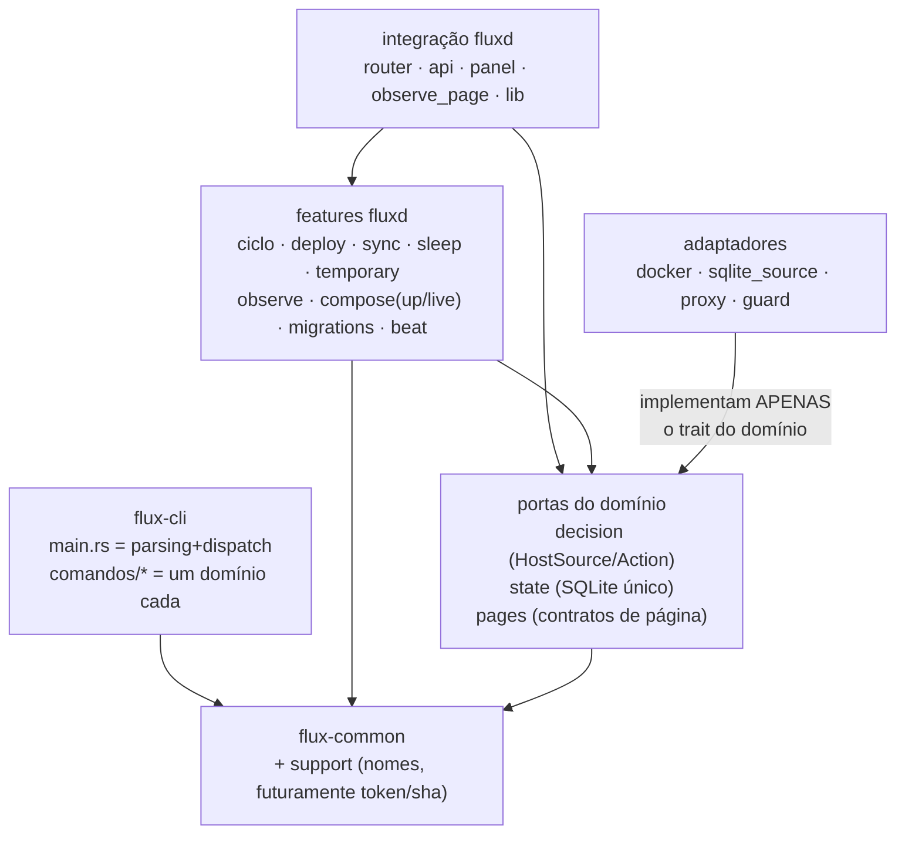

# Mapa de dependências

Fonte: mapa consolidado da auditoria (arestas verificadas por grep/leitura pelos auditores) + confirmações desta sessão. FATO salvo indicação.

## 1. Entre crates (grafo atual)



- **CICLO REAL: NENHUM.** O grafo é um DAG; grep de `fluxd::` em flux-cli e flux-common: vazio; `sha2` é a única dependência morta (common/Cargo.toml:11).
- Dentro do flux-common: `host.rs` → `config.rs` (DomainConfig, host.rs:5, 47-59); `config.rs` → `error.rs` (FluxError no parse estrito, config.rs:12, 42-56). Direção sã.
- Única aresta de teste fora do padrão: `flux-cli/tests/sync_tests.rs:7` compila `src/sync.rs` avulso via `#[path]` — ponte PERMANENTE (main.rs:13 já declara `mod sync;` e o crate não tem `[lib]`); impõe auto-contenção de src/sync.rs (zero `crate::`, grep confirmado).

## 2. Dentro do fluxd (camadas atuais)

```
                 ┌────────────────────────────────────────────────────────────┐
   COMPOSIÇÃO    │ lib.rs (AppState, serve) · main.rs (bin fino, 88 l.)       │
                 └──────────────┬─────────────────────────────────────────────┘
                                │ monta e spawna
                 ┌──────────────▼─────────────────────────────────────────────┐
   INTEGRAÇÃO    │ router.rs (:8080, despacho de Action)                      │
   (request path │ api.rs (:7420, gate+handlers)          deploy.rs (rota      │
   + superfícies │ panel.rs → observe_page.rs              pública)            │
   HTTP)         │ beat.rs · pages.rs · edge.rs · waf.rs · proxy.rs           │
                 └───────┬──────────────────┬─────────────────┬───────────────┘
                         │ consome          │ consome         │
                 ┌───────▼──────────────────▼─────────────────▼───────────────┐
   FEATURES      │ ciclo · deploy(pipeline) · sync(status) · sleep             │
                 │ temporary · observe · compose(up/live/override)             │
                 │ db(migrations in-container) · guard · events                │
                 └───────┬──────────────────┬─────────────────┬───────────────┘
                         │                  │                 │
                 ┌───────▼─────────┐ ┌───────▼────────┐ ┌──────▼─────────────┐
   PORTAS        │ decision.rs     │ │ state.rs       │ │ flux-common        │
   (puro/estado) │ Action,         │ │ SQLite WAL     │ │ (config, host,     │
                 │ trait HostSource│ │ schema v1→v4   │ │ protocol, error)   │
                 └───────┬─────────┘ └───────┬────────┘ └────────────────────┘
                         │ implementam       │
                 ┌───────▼───────────────────▼────────────────────────────────┐
   ADAPTADORES   │ docker.rs (DockerSource) · sqlite_source.rs (SqliteSource) │
                 └────────────────────────────────────────────────────────────┘
```

Arestas relevantes (todas verificadas por leitura/grep na auditoria):

| De | Para | Nota |
|---|---|---|
| decision.rs | flux-common/host.rs | Núcleo puro: `ManagedHost::parse_custom` com closures sobre HostSource (decision.rs:108-110). Só flux-common + tipos http. |
| docker.rs | decision.rs | DockerSource implementa HostSource (docker.rs:275-319) — adaptador implementando a porta. **block_in_place+block_on dentro dos métodos síncronos (281-287, 308-314)** — AF-10. |
| sqlite_source.rs | decision.rs | SqliteSource implementa HostSource (sqlite_source.rs:21-112); stub branch_exists = true (59-64) duplicado com docker.rs:290-293. |
| router.rs | decision.rs | Despacha Action; enum Source delega por método (72-112) — adaptador de lifetime, MANTIDO (divergência resolvida). |
| router.rs | proxy/pages/deploy/panel | Action::Proxy→forward/forward_ws (218-221), páginas, painel via oneshot (293-297), deploy atrás de flag (304-310), beat (40, 61-66). |
| edge.rs / waf.rs | decision.rs | Reuso de `wants_json` (edge.rs:329, waf.rs:378) — borda e decisão nunca discordam sobre quem é API. |
| proxy.rs | beat.rs | **INVERSA:** infra injeta `crate::beat::SCRIPT` (proxy.rs:106) — AF-11. |
| deploy.rs | api.rs | **Potencial ciclo:** helpers `pub(crate)` de outra superfície HTTP (deploy.rs:56) — AF-11; resolvido por foco-api-auth. |
| lib.rs | deploy.rs | AppState monta deploy_limiter com consts do feature (lib.rs:65-69) — AF-11. |
| api.rs | compose/db/ciclo/sync/state | Orquestrador: trocar_cor/DRAIN (api.rs:717-733), subir_projeto (895), saude_ok (484), ensure_schema_com_seed (683), rotas de ciclo (60-62). |
| compose.rs | docker/guard/sqlite_source | up lê estado via DockerSource (514-525), guard no repo (287-305, 1087-1116), SqliteSource fallback no live (552). |
| db.rs | docker.rs | Migrations executam via find_app_container + bollard exec (db.rs:21, 367-422) — esqueleto duplicado com ciclo.rs:375-458 (AF-04 do plano: dados-exec-container-unificado). |
| sleep.rs | docker.rs/state.rs | Sweep re-sincroniza engine e dorme/acorda via DockerSource (181-198, 232-235); limits_for re-parseia TOML do SQLite (84-99). |
| observe.rs | sleep.rs | Reusa now_epoch/cpu_percent (43, 597) — sem reimplementar. Schema próprio (67-95) — AF-13. |
| observe_page.rs | observe.rs | Consumidor puro da API de consulta (31, 607-746) — exemplo de camada certa. |
| panel.rs | observe_page.rs / sync.rs / state.rs | Monta /observe com auth herdada (168); request_rescan/sync_states (360, 926); **SQL inline próprio** (447-586, 1157-1165) — AF-14. |
| ciclo/api/compose/deploy | temporary.rs | **PROJECTS_ROOT_PADRAO (temporary.rs:25) importada por 4 módulos não-temporários** (ciclo.rs:172, api.rs:878, compose.rs:260, deploy.rs:361) — AF-16. |
| events.rs | state.rs | INSERT direto com `with` (12-22); consumida por ~10 módulos. |
| beat.rs | docker.rs/sqlite_source.rs | Seleção "engine senão SQLite" inline (46-50) — AF-02. |

## 3. Acoplamentos problemáticos (resumo com direção do conserto)

1. **4× seleção "Docker senão SQLite"** (router.rs:142-145, beat.rs:46-50, panel.rs:406-417, compose.rs:548-553) — a porta `HostSource` já existe; falta construtor único. AF-02.
2. **4-6× listagem por label** com erros divergentes (`unwrap_or_default` docker.rs:47; `.ok()?` :63) — consertado por `dados-listagem-por-label`. AF-03.
3. **deploy.rs → api.rs** (helpers pub(crate)) — potencial ciclo; consertado por `foco-api-auth` com re-export. AF-11.
4. **proxy.rs → beat.rs** (infra conhece feature) — registrado; conserto futuro por injeção. AF-11.
5. **lib.rs → deploy.rs** (consts de feature no AppState) — registrado. AF-11.
6. **ciclo/api/compose/deploy → temporary.rs** (const de layout) — `nucleo-raiz-projetos` reduzido a doc (+movida opcional). AF-16.
7. **state.rs ↔ sqlite_source.rs** por chave de convenção `proxy_target/{name}/{env}` (escrita state.rs:244, leitura sqlite_source.rs:81, sem símbolo compartilhado) — registrado em AF-14.
8. **3 semânticas de normalização de Host** (host.rs:60-61 / edge.rs:394-417 / router.rs:131-137+beat.rs:39-42) — IPv6 divergente, latente. AF-09.
9. **Trait síncrono escondendo block_in_place** (docker.rs:281-287, 308-314; compose.rs:843-853) — AF-10.

## 4. Direção-alvo (pós-refatoração)



- **Entre crates:** seta única — `flux-cli` e `fluxd` dependem EXCLUSIVAMENTE de `flux-common`; nunca CLI→fluxd nem fluxd→CLI (já vale nos Cargo.toml).
- **Dentro do fluxd:** integração → features → portas → adaptadores → (de volta) APENAS ao trait. O domínio nunca aponta para infra.
- **Convergências esperadas ao final do plano:** SQL de leitura do painel isolado em `panel/leitura.rs` (passo intermediário honesto para a direção "state como único lar de SQL"); helpers de plataforma que existem em cópia dentro de cada crate consolidados no próprio crate (`foco-cli-contexto`, `foco-api-auth`, `nucleo-helper-erro`); escape/CSS com dono único por família visual; validador de nome e FromStr de framework com fonte única no flux-common; VM_HOST/VM_USER com fonte única no tunel.rs.
- **Resultado esperado:** qualquer feature nova nasce consumindo decision+state+support sem tocar router nem api; as cópias da seleção "Docker senão SQLite" colapsam na porta `HostSource` (quando o construtor único for feito — dívida registrada em AF-02).
- **Fora da direção-alvo nesta rodada (registrados):** migração de `spec_da_sessao` para sync.rs; construtor único de HostSource; resolução async antes de `decide()`; migração dos helpers de token/sha para flux-common; um único lar de schema (state.rs + SCHEMA_OBSERVE).
